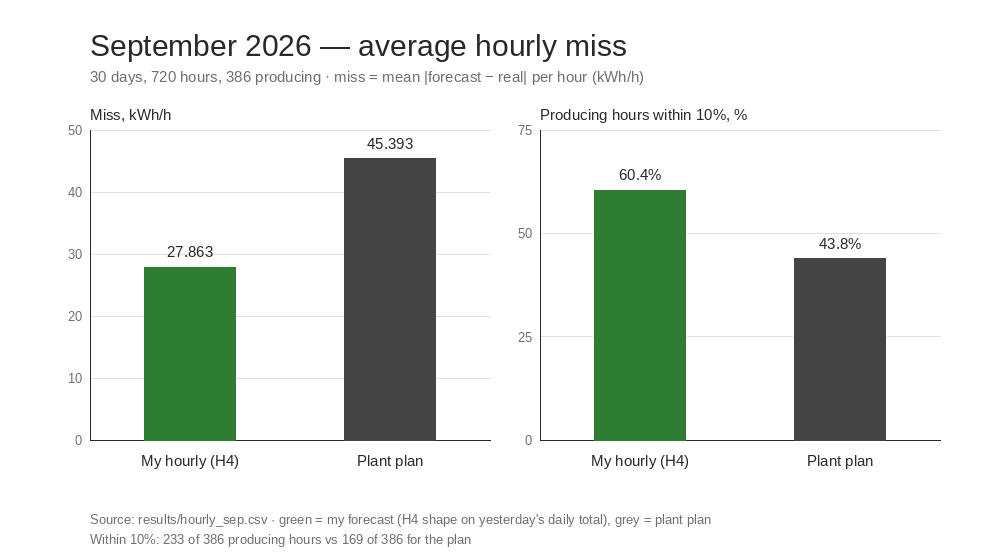

# Results — Kargaly solar forecast

**Date:** 2026-10-28 · **Place:** Kargaly, 42.866 N 68.376 E

All numbers in these tables come from files in `results/` (or `data/` where a row says so); the last column names the file behind each row. No model was trained for this report and no existing file in `results/` was changed.

**Definitions.** Miss = mean |forecast − real| per day, in kWh. Miss % = miss divided by the month's average real output. Accuracy = 100% − miss %. Within 10% = days where |forecast − real| ≤ 10% of the real value.

## July 2026 — 25 clean days

Average real output: **4,768.400 kWh** (`results/baselines.csv`). 7–12 July are outage / plan-zero days and are excluded.

| Forecast | Miss, kWh | Miss % | Accuracy | Within 10% | Source |
|---|---:|---:|---:|---:|---|
| Plant plan | 879.280 | 18.44% | 81.56% | 10 of 25 (40%) | `results/baselines.csv`, `results/baselines_july_days.csv` |
| Yesterday (tomorrow = today) | 622.280 | 13.05% | 86.95% | 14 of 25 (56%) | `results/baselines.csv`, `results/baselines_july_days.csv` |
| 7-day median | 723.640 | 15.18% | 84.82% | 13 of 25 (52%) | `results/baselines.csv`, `results/baselines_july_days.csv` |
| My model (A) | 974.721 | 20.44% | 79.56% | 8 of 25 (32%) | `results/baselines.csv`, `results/model_july.csv` |
| My model 2 | — not run | — | — | — | — |
| My model 3 | 610.367 | 12.80% | 87.20% | 10 of 25 (40%) | `results/model_search_days.csv` |

My model 3's July row comes from its walk-forward search period, so it is descriptive, not a fresh test. My model 2 was never run on July.

## September 2026 — 30 days

Average real output: **7,556.033 kWh** (`results/baselines_sep.csv`). All 30 days are without a note.

| Forecast | Miss, kWh | Miss % | Accuracy | Within 10% | Source |
|---|---:|---:|---:|---:|---|
| Plant plan | 1,015.100 | 13.43% | 86.57% | 12 of 30 (40%) | `results/baselines_sep.csv`, `results/baselines_sep_days.csv` |
| Yesterday (tomorrow = today) | **512.600** | **6.78%** | **93.22%** | **23 of 30 (77%)** | `results/baselines_sep.csv`, `results/baselines_sep_days.csv` |
| 7-day median | 799.300 | 10.58% | 89.42% | 17 of 30 (57%) | `results/baselines_sep.csv`, `results/baselines_sep_days.csv` |
| My model (A) | — not run | — | — | — | — |
| My model 2 | 1,576.493 | 20.86% | 79.14% | 5 of 30 (17%) | `results/baselines_sep.csv`, `results/model2_sep.csv` |
| My model 3 | 1,542.506 | 20.41% | 79.59% | 1 of 30 (3%) | `results/baselines_sep.csv`, `results/model3_sep.csv` |

The lowest September miss is yesterday's real kWh (512.600 kWh, 6.78%), so it is the chosen rule. September was already used while choosing the models, so this is a check, not an unseen exam.

## September 2026 — hourly shape

30 days, 720 hours in total, of which **386 produce power**. My hourly forecast keeps yesterday's daily total and splits it over the day with H4 (the average shape of the last 7 clean days); the plant's hourly plan is the baseline. Source: `results/hourly_sep.csv`.

| Forecast | Days | Hours | Miss, kWh/h | Miss % | Within 10%, hours | Daily miss, kWh | Source |
|---|---:|---:|---:|---:|---:|---:|---|
| My hourly forecast (H4) | 30 | 720 | **27.863** | **8.85%** | 233 of 386 (60.4%) | 512.600 (6.78%) | `results/hourly_sep.csv` |
| Plant plan (hourly) | 30 | 720 | 45.393 | 14.42% | 169 of 386 (43.8%) | 1,015.100 (13.43%) | `results/hourly_sep.csv` |

"Within 10%, hours" counts producing hours where the hourly forecast was within 10% of the real hourly output. The daily miss in the last column is the same daily number as in the table above.

### The 30 September story

The hardest September day. Real output fell to **4,631 kWh**, while the plan said **7,573** and the day before had produced **7,392** (`results/september_daily_table.csv`, `results/baselines_sep_days.csv`). Sun fell from 17.85 to 12.83 MJ/m² (**−28.1%**) and mean cloud cover rose from 8% to 55% (`data/table.csv`). Every forecast failed, and the "same as yesterday" rule failed too:

| Forecast for 30 Sep | kWh | Miss, kWh | Miss % of real | Source |
|---|---:|---:|---:|---|
| Yesterday (29 Sep real) | 7,392 | 2,761 | 59.62% | `results/baselines_sep_days.csv` |
| 7-day median | 7,487 | 2,856 | 61.67% | `results/baselines_sep_days.csv` |
| Plant plan | 7,573 | 2,942 | 63.53% | `results/baselines_sep_days.csv` |
| August-fit weather model | 12,713.133 | 8,082.133 | 174.52% | `results/september_daily_table.csv` |

Hour by hour (`data/hourly.csv`) the day held up until midday and then collapsed: at 12:00 real output was 777.958 kWh against a plan of 1,057, at 14:00 it was 216.545 against 905, and at 15:00 81.800 against 691. The H4 shape, which copies yesterday's afternoon, put far too much power after 14:00. A cloud switch would not have saved it: the chosen threshold is 30% and the sun drop was 28.1% (`results/cloud_rule.csv`, `data/table.csv`). This is the case a day-ahead forecast built from yesterday's output cannot see; the August-fit weather model over-predicted the day even more.

## September 2026 — lead days

How old the last real day is when the forecast is made. All 30 September days; average real output 7,556.033 kWh. "1 day before" is the rule the page uses. Source: `results/lead_days_sep.csv`.

| Forecast | Days | Miss, kWh | Miss % | Accuracy | Within 10% | Source |
|---|---:|---:|---:|---:|---:|---|
| Real 1 day before (tomorrow = today) | 30 | **512.600** | **6.78%** | **93.22%** | 23 of 30 (76.67%) | `results/lead_days_sep.csv` |
| Real 2 days before | 30 | 747.000 | 9.89% | 90.11% | 20 of 30 (66.67%) | `results/lead_days_sep.csv` |
| Real 3 days before | 30 | 885.600 | 11.72% | 88.28% | 18 of 30 (60.00%) | `results/lead_days_sep.csv` |
| Plant plan | 30 | 1,015.100 | 13.43% | 86.57% | 12 of 30 (40.00%) | `results/lead_days_sep.csv` |

## October 2026 — final exam (unseen test)

The first month the methods never saw. **26 clean days** (1–27 October); 4 October was an outage and is counted apart. Methods were fixed before the exam. Source: `results/october_exam.csv`.

| Forecast (daily) | Days | Miss, kWh | Miss % | Accuracy | Within 10% | Source |
|---|---:|---:|---:|---:|---:|---|
| Plant plan | 26 | 1,651.382 | 24.96% | 75.04% | 10 of 26 | `results/october_exam.csv` |
| Yesterday (tomorrow = today) | 26 | 1,109.877 | 16.78% | 83.22% | 15 of 26 | `results/october_exam.csv` |
| 7-day median | 26 | 1,011.987 | 15.30% | 84.70% | 15 of 26 | `results/october_exam.csv` |
| Cloud rule (T=30%) | 26 | 1,018.777 | 15.40% | 84.60% | 15 of 26 | `results/october_exam.csv` |

The cloud rule fired on 4 and 12 October (source: `results/october_exam.csv`, note column).

| Forecast (hourly) | Days | Hours | Miss, kWh/h | Miss % | Accuracy | Within 10%, hours | Source |
|---|---:|---:|---:|---:|---:|---:|---|
| Plant plan (hourly) | 26 | 624 | 76.301 | 27.68% | 72.32% | 84 of 292 (28.8%) | `results/october_exam.csv` |
| My hourly (H4) | 26 | 624 | **52.687** | **19.11%** | **80.89%** | 155 of 292 (53.1%) | `results/october_exam.csv` |

292 of the 624 hours produce power. The hourly forecast is the chosen H4 shape (the average shape of the last 7 clean days) applied to yesterday's daily total.

## By month — plan vs "tomorrow = today"

Same rule in every month: the forecast is the last day without a note, and both forecasts are scored on the same days. Days with a note (outage / plan-zero) are left out. Source: `results/by_month.csv`.

| Month | Clean days | Plant plan, kWh | Plan miss % | My rule, kWh | My miss % | My days within 10% |
|---|---:|---:|---:|---:|---:|---:|
| June 2026 | 29 | 1,888.000 | 38.03% | **1,485.621** | **29.92%** | 9 of 29 |
| July 2026 | 25 | 879.280 | 18.44% | **621.200** | **13.03%** | 14 of 25 |
| August 2026 | 26 | 1,883.462 | 35.70% | **1,250.923** | **23.71%** | 9 of 26 |
| September 2026 | 30 | 1,015.100 | 13.43% | **512.600** | **6.78%** | 23 of 30 |
| October 2026 | 26 | 1,651.382 | 24.96% | **1,109.877** | **16.78%** | 15 of 26 |

**My rule was closer than the plant plan in 5 of 5 months.**

Reading notes: 1 June is left out because neither forecast has a previous day. Note days are left out: 7–12 July (outage / plan-zero), 13, 14, 17 August (outage), 18, 20 August (plan-zero) and 4 October (outage). On 13 July the rule takes 6 July (4,133 kWh) rather than the plan-zero day 12 July, so the July row is 1.080 kWh below the 622.280 in `results/baselines.csv`, which used the calendar day before.

## Limits — what these numbers do not show

- **One plant, one place.** Kargaly, 42.866 N 68.376 E (`data/weather_meta.json`). Nothing here is tested on another plant.
- **Coverage.** Daily: 122 days, 1 June – 30 September (`data/daily.csv`) plus 27 days, 1–27 October (`data/october_daily.csv`). Hourly: 1,464 hours / 61 report days, August–September (`data/hourly.csv`) plus 648 hours / 27 days, October (`data/october_hourly.csv`), i.e. 2,112 hours / 88 report days. There is **no hourly data for June–July**.
- **Days left out.** 11 days in `data/daily.csv` are marked and not scored: 6 outage (7–9 July, 13, 14, 17 August) and 5 plan-zero (10–12 July, 18, 20 August). In October, 4 October is an outage counted apart (`results/october_exam.csv`).
- **Plant power.** The file `SYP/пояснительная записка.PDF` gives modules of 455 and 355 W, BlueSunPV 100 kW inverter stations, one group of 10 modules = 4.55 kW (13 panels = 4.615 kW) and a peak of 48–92 kW when one inverter station is down. It gives **no total plant power**, so this report makes no claim about it.
- **Weather is one grid cell.** The request was for 42.866/68.376; Open-Meteo answered for 42.8471/68.4, about 2.3 km away, elevation 197 m. The daily models use daily values only (radiation sum, mean cloud cover, maximum temperature) — `data/weather_meta.json`.
- **Hourly scoring.** Night zeros count in the hourly miss but not in "within 10%": 386 of 720 September hours produce power (`results/hourly_sep.csv`).
- **Short exam month.** October has 27 days, one of them an outage, so the exam rests on **26 clean days** (`results/october_exam.csv`). Winter months with lower sun are not tested.
- **Not tested:** a real phone, a second browser, an Open-Meteo outage. The cost of 1 kWh of imbalance and the plan submission deadline are still unknown.
